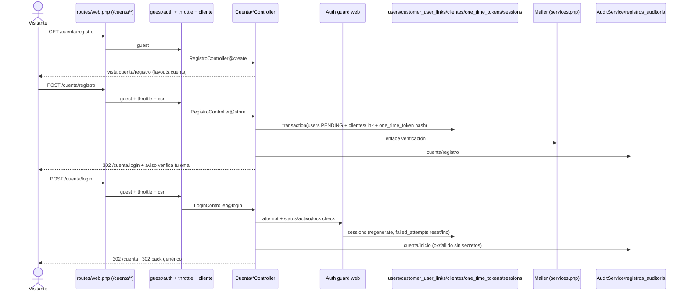
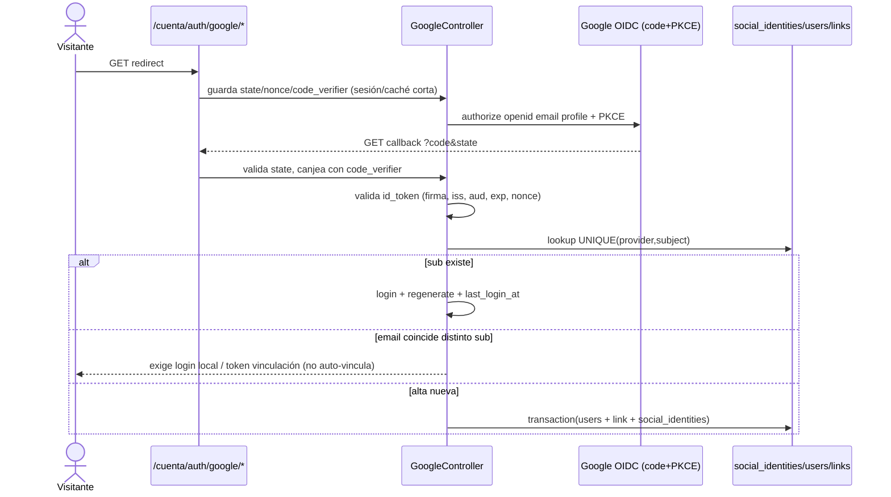

# Diseño Técnico — Autenticación pública de clientes (`/cuenta/*`)

## Visión General

Se añade autenticación de clientes a la web pública sin tocar el panel operativo: registro/login/logout/recuperación locales sobre el guard `web` existente + pivote `customer_user_links` + tokens de un solo uso, y Google OIDC como fase posterior con `social_identities`. Sin `auth_users` UUID, sin `auth_sessions` custom, sin cookies separadas, sin renombrar `/dashboard` (ver `docs/contraste-autenticacion-publica.md §3.1`).

Stack: Laravel 12 / PHP 8.2, Blade + Tailwind 4 (Vite 7, dark mode con tokens `.bg-surface/.input-main/...`), SQLite dev, tests en SQLite memoria (`phpunit.xml`), zona `America/Lima` (`config/app.php:68`, `now()`/Carbon, `->toDateString()`).

---

## Arquitectura

Patrón MVC Laravel + sesión `database` existente. Aislamiento por rutas/rol/Policies, no por guards.



Google (fase posterior):



### Decisiones de diseño

- **Reutilizar `users` (bigint) como identidad.** Crear `auth_users` UUID duplicaría `users`, invalidaría `spatie guard web`, `Gate::before`, 17 permisos, `AuthSeeder`, `registros_auditoria.usuario_id FK`, `CajaService.user_id` y ventas. Solo columnas aditivas nullable en `users`.
- **Reutilizar `sessions` nativa.** `auth_sessions` paralela crearía doble fuente de verdad y perdería `Auth::attempt/regenerate/remember_token` y tests `LoginTest/SesionesTest`. Revocación = `logoutOtherDevices + delete sessions + regenerate`; expiración = `SESSION_LIFETIME` + middleware `last_seen` si se exige idle/absoluta diferenciada.
- **Un guard `web`, una cookie.** Dos cookies host-only exigen doble driver/dominio o auth manual; rompe `auth` middleware. Separación = prefijo `/cuenta/*` + rol `Cliente` + Policies. Segundo guard/`Sanctum` solo si futuro multi-dominio/API lo exige.
- **No incrustar auth en `clientes`.** `dni` nullable no-unique, sin email; el vínculo es pivote con `estado`, preparado para 1:1 hoy (`UNIQUE(user_id)`) ampliable a N:M (`UNIQUE(user_id,cliente_id)`) cuando se resuelva D1.
- **No auto-vincular Google por email.** `provider_email` coincidente sin `sub` conocido exige prueba de control. `UNIQUE(provider, provider_subject)` obligatorio; email nunca es identificador externo.
- **Bcrypt actual, no Argon2id ya.** `User casts password hashed`; cambiar driver exige rehash coordinado. `DataNormalizer` para email minúsculas/DNI/teléfono/placa/nombres; `now()` Lima en todo tiempo.
- **Frontend modular Vite.** Cada vista de `/cuenta/*` con su `resources/js/cuenta/*.js` registrado en `vite.config.js input` + `@vite([...])` al final de `@section('content')`; sin `<script>` inline salvo `window.* = @json(...)` antes del `@vite` (convención `.kiro/specs/js-modularization`).
- **Rutas estáticas antes que resource** (`routes/web.php` gotcha: `clientes.consultarDni`, `lavados.confirmados`, producto `buscar`).

---

## Componentes e Interfaces

### 1. Migraciones (aditivas, idempotentes, `bigint`, Lima)

| Migración | Cambio |
|---|---|
| `xxxx_add_cuenta_fields_to_users_table` | `status varchar(30) default 'ACTIVE'`, `password_changed_at nullable`, `failed_attempts int default 0`, `locked_until nullable`, `last_login_at nullable`, índice `status`. Todo nullable/aditivo; backfill `status=ACTIVE` donde `activo=true`, `SUSPENDED` donde `activo=false`. |
| `xxxx_create_customer_user_links_table` | `id bigint PK`, `user_id FK->users cascade UNIQUE` (1:1; si D1=N:M, `unique(user_id,cliente_id)` en su lugar), `cliente_id FK->clientes cascade`, `estado varchar(20) default 'ACTIVO'`, `rol varchar(30) nullable`, timestamps, índices `(user_id) (cliente_id)`. |
| `xxxx_create_one_time_tokens_table` | `id bigint PK`, `user_id FK->users cascade`, `purpose varchar(30)` (`verificacion/recuperacion/vinculacion`), `token_hash varchar(255) unique`, `expires_at`, `consumed_at nullable`, `created_at`; índice `(token_hash, expires_at)`. Token aleatorio `Str::random(64)`, solo hash en BD. |
| `xxxx_create_social_identities_table` (fase Google) | `id bigint PK`, `user_id FK->users cascade`, `provider varchar(20)`, `provider_subject varchar(255)`, `provider_email nullable`, `provider_email_verified bool nullable`, `linked_at`, `last_login_at nullable`, `UNIQUE(provider, provider_subject)`, índice `user_id`. |
| Seeders | `PermissionSeeder`: `firstOrCreate('acceso-cuenta', guard web)` — rol `Cliente` SIN permisos; `AuthSeeder`: rol `Cliente`; `Gate::before` NO se toca. `User` nuevo: `syncRoles(['Cliente'])`. |

`password_reset_tokens` existente se mantiene como alternativa; el diseño usa `one_time_tokens` para verificación/vinculación y recuperación unificada (decidir uno en implementación; no duplicar flujos).

### 2. Modelos

- `User`: añade `MustVerifyEmail` (activar), fillable `status,password_changed_at,failed_attempts,locked_until,last_login_at`, casts, relaciones `clientes(): belongsToMany(Cliente::class,'customer_user_links')`, `customerLinks(): hasMany`, `socialIdentities(): hasMany`, `oneTimeTokens(): hasMany`. Registrar en `AuditServiceProvider::$modelos` + `AuditService::AUDITABLE` si se audita su ciclo (excluir `password/remember_token` ya en `SENSIBLES`).
- `CustomerUserLink`, `OneTimeToken`, `SocialIdentity`: `belongsTo user/cliente`, fillables mínimos, registrados en auditoría según `EXCLUIDOS`.
- `Cliente`: sin cambios de credenciales; solo relación inversa `users()` vía pivote.

### 3. Controladores `app/Http/Controllers/Cuenta/*`

| Controlador | Métodos | Notas |
|---|---|---|
| `RegistroController` | `create / store` (`guest+throttle`) | Valida `nombre,email unique,password confirmed|min:8,dni/telefono opcionales`; `DB::transaction`; `Hash::make`; normaliza email/DNI/teléfono; asigna rol `Cliente`; mail verificación (signed URL o token); `AuditService::registrar(user,'registro',...)`. |
| `VerificacionController` | `verify / reenviar` (`throttle`) | Consume token un solo uso; `email_verified_at=now(), status=ACTIVE`. |
| `LoginController` (cuenta, nombre distinto al `Auth\LoginController` operativo) | `create / store / destroy` | `guest` para login, `auth` para logout; checks `status/activo/locked_until/email_verified`; `Auth::guard('web')->attempt($creds)`; `regenerate`; anti-enumeración genérica; `failed_attempts/locked_until` progresivo; auditoría ok+fallido. |
| `RecuperacionController` | `create / store / edit / update` (`throttle`) | Respuesta siempre genérica; token corto; `Hash::make + password_changed_at=now()` + revocación global. |
| `CuentaController` + `VehiculoController/LavadoController` (zona privada) | `show/edit/update`, `index/show` scopeados | `auth + middleware cliente + can:acceso-cuenta`; scoping por vínculo; `paginate(10)`. |
| `GoogleController` (fase posterior) | `redirect / callback / vincular / desvincular` | `state/nonce/code_verifier` en sesión/caché corta; `socialite` + validación `id_token`; política no-auto-vínculo; notificación + auditoría; prohíbe quitar último método. |

Validaciones server-side espejan `DataNormalizer` y `docs/patron-validacion-formularios.md`; errores junto al campo (`@error`).

### 4. Rutas `routes/web.php` (aditivas; estáticas antes que resource)

```php
// Zona pública cuenta — guest
Route::middleware('guest')->prefix('cuenta')->name('cuenta.')->group(function () {
    Route::get('/registro', ...)->name('registro');  Route::post('/registro', ...)->middleware('throttle:6,1');
    Route::get('/login', ...)->name('login');        Route::post('/login', ...)->middleware('throttle:5,1');
    Route::get('/verificacion/{token}', ...)->name('verificacion');
    Route::post('/recuperacion', ...)->middleware('throttle:3,1'); ...
    Route::get('/auth/google/redirect', ...); Route::get('/auth/google/callback', ...)->middleware('throttle:10,1');
});
// Zona privada cuenta — auth + cliente
Route::middleware(['auth','cliente','can:acceso-cuenta'])->prefix('cuenta')->name('cuenta.')->group(function () {
    Route::post('/logout', ...)->name('logout');
    Route::get('/', ...)->name('panel');
    Route::get('/vehiculos/buscar', ...); // estática ANTES del resource
    Route::resource('/vehiculos', ...)->only(['index','show']);
    Route::post('/sesiones/revocar-todas', ...);
});
```

Middleware `cliente` (nuevo, `app/Http/Middleware/EnsureCliente.php`): `auth + rol Cliente + status ACTIVE + activo + email verificado`; si no, 403/redirect con `error_caja`-like (`error_cuenta`) explicado en vista. Registrar en `bootstrap/app.php`. No tocar middlewares del panel.

### 5. Vistas `resources/views/cuenta/*` (+ `layouts/cuenta.blade.php` futuro)

MVP inmediato: `cuenta/panel.blade.php` (ya creada) como plantilla estática de bienvenida; extiende `layouts/publica`, clases dark `.bg-surface/.text-primary/.text-secondary/.border-main`, sin `<script>` inline y sin módulo JS (no requiere entrada en `vite.config.js`).

Resto de la zona (`registro, login, verificacion, recuperacion, vehiculos/*`): layout propio futuro con `@vite(['resources/css/app.css','resources/js/cuenta/app.js'])`; cada vista con su `resources/js/cuenta/*.js` en `vite.config.js input` + `@vite` al final de `@section('content')`. Sin lógica inline. Mensajes anti-enumeración genéricos. Modal "cuenta requerida/suspendida" análogo al modal `error_caja`. `GET /cuenta` (nombre `cuenta.panel`) renderiza el panel; guest → `/cuenta/login`.

### 6. Auth externo, correo, auditoría, limpieza

- `config/services.php`: bloque `google` (`client_id/secret/redirect`) por entorno + `.env.example` (`GOOGLE_CLIENT_ID/SECRET/REDIRECT_URI`); secretos nunca en repo; `redirect URI` exacta registrada en consola Google.
- Correo: reutilizar mailer configurado (`postmark/resend/ses`); plantillas Blade ES; colas con `queue:listen` (`composer run dev` ya lo levanta).
- `AuditService`: extender `registrarSesion` (fallidos con `user_id` nullable, revocación, recuperación, vinculación) + `SENSIBLES += token_hash, code_verifier, state, nonce`; nunca `password/code/id_token`.
- Scheduler (`routes/console.php`): `sessions` expiradas (`SESSION_LIFETIME`), `one_time_tokens` (`expires_at < now() or consumed_at` antiguo); métricas login/callback/bloqueos.

---

## Modelos de Datos

```mermaid
erDiagram
    users {
        bigint id PK
        string name
        string email UK
        string password
        timestamp email_verified_at
        string status
        boolean activo
        int failed_attempts
        timestamp locked_until
        timestamp password_changed_at
        timestamp last_login_at
    }
    clientes {
        bigint id PK
        string dni
        string nombre
        string apellido_paterno
        string apellido_materno
        string telefono
    }
    customer_user_links {
        bigint id PK
        bigint user_id FK_UK
        bigint cliente_id FK
        string estado
        string rol
    }
    one_time_tokens {
        bigint id PK
        bigint user_id FK
        string purpose
        string token_hash UK
        timestamp expires_at
        timestamp consumed_at
    }
    social_identities {
        bigint id PK
        bigint user_id FK
        string provider
        string subject
        string provider_email
    }
    automotores {
        string placa PK
        bigint cliente_id FK
    }
    users ||--o{ customer_user_links : "tiene"
    clientes ||--o{ customer_user_links : "enlazado"
    users ||--o{ one_time_tokens : "emite"
    users ||--o{ social_identities : "vincula"
    clientes ||--o{ automotores : "posee"
```

Convenciones: PK `bigint` (salvo `placa`), FKs `cascade` salvo `registros_auditoria.usuario_id restrict` (no tocar), `json` para `datos_antes/después`, timestamps `now()` Lima, email normalizado minúsculas + `DataNormalizer`, `unique(provider, provider_subject)` + `unique(token_hash)` + `unique(user_id)` (o compuesta si N:M).

---

## Propiedades de Corrección

*Propiedad = invariante verificable por máquina sobre todas las ejecuciones; cada una genera un Property Test de ≥100 iteraciones (`faker`), tag `// Feature: autenticacion-publica-clientes, Property {N}: ...`.*

### Propiedad 1: Registro crea identidad + vínculo + token hasheado y rol Cliente sin permisos operativos
*Para cualquier* payload válido, `POST /cuenta/registro` crea `users(status=PENDING, rol Cliente, 0 permisos acceso-*)` + `customer_user_links ACTIVO` + `one_time_tokens(token_hash≠claro)` en transacción. **Valida: Req. 1.3, 1.6.**

### Propiedad 2: Sin verificación no hay login
*Para cualquier* cuenta `PENDING` con password correcta, `POST /cuenta/login` la rechaza; tras consumir verificación válida, la misma password entra. **Valida: Req. 2.1, 2.2, 3.2.**

### Propiedad 3: Tokens de un solo uso con expiración
*Para cualquier* token, el segundo consumo, el expirado (`expires_at < now()`) o el hash alterado fallan; el primero válido tiene éxito. **Valida: Req. 2.3, 2.4, 5.2, 5.3.**

### Propiedad 4: Anti-enumeración en login/recuperación
*Para cualquier* email inexistente, existente-no-verificado o password errónea, `POST /cuenta/login` y `POST /cuenta/recuperacion` responden indistinguibles (mismo status/cuerpo genérico). **Valida: Req. 3.3, 5.1.** (Requiere actualizar `LoginTest` operativo si se unifica mensaje.)

### Propiedad 5: Throttle + bloqueo progresivo
*Para cualquier* ráfaga > umbral, el intento N+1 recibe 429 y `failed_attempts/locked_until` avanzan; tras expirar el bloqueo con credencial válida entra. **Valida: Req. 3.4, 9.2.**

### Propiedad 6: Separación público↔operativo
*Para cualquier* usuario solo-`Cliente`, toda ruta `permission:acceso-*` responde 403; *para cualquier* operador sin vínculo, toda `/cuenta/*` privada responde 403/redirect. **Valida: Req. 6.2, 6.3.**

### Propiedad 7: Ownership por objeto (IDOR/BOLA)
*Para cualquier* par de clientes A≠B y recurso de B (placa/lavado), el cliente A autenticado recibe 403 aunque conozca el ID; el listado de A nunca contiene filas de B. **Valida: Req. 7.1, 7.2.**

### Propiedad 8: Revocación global invalida sesiones viejas
*Para cualquier* cuenta con ≥2 sesiones, tras cambio password/recuperación/vinculación o `revocar-todas`, solo la sesión actual sobrevive. **Valida: Req. 4.2, 4.3.**

### Propiedad 9: Google vincula por `provider+sub`, nunca por email solo
*Para cualquier* `id_token` válido con `sub` nuevo pero email de cuenta existente, el sistema NO crea sesión vinculada sin prueba de control; con `sub` conocido sí; con `iss/aud/exp/nonce` inválidos o `state` distinto siempre falla. **Valida: Req. 8.2–8.4.**

### Propiedad 10: Auditoría sin secretos y normalización estable
*Para cualquier* flujo (registro, login ok/fallido, revocación, recuperación, Google), existe fila `registros_auditoria` sin `password/token/code/id_token`, y reintentos con `DNI/teléfono/email` equivalentes tras `DataNormalizer` producen el mismo vínculo. **Valida: Req. 9.3, 9.4.**

---

## Manejo de Errores

| Escenario | Comportamiento |
|---|---|
| Validación registro/login/recuperación | `back()->withErrors()->withInput()` salvo `password`; `@error` junto al campo; email normalizado antes de `unique`. |
| Email duplicado en registro | 422 en campo `email` (único caso donde se revela existencia). |
| Login cuenta inexistente/incorrecta/no verificada/bloqueada/suspendida | Mismo 302 genérico + `failed_attempts++`; sin distinguir causa en UI. |
| Token inválido/expirado/consumido | 403/410 genérico + opción reenvío throttled. |
| Sin rol `Cliente` en `/cuenta/*` privada | 403 + vista/modal `error_cuenta`; sin filtrar existencia de recursos. |
| Solo-`Cliente` en panel operativo | 403 (no redirect a login para no confundir sesión válida sin permiso). |
| Sesión expirada/revocada/cuenta suspendida | Como no autenticado → `/cuenta/login`. |
| Callback Google inválido (`state/nonce/iss/aud/exp/firma`) | 403 + `google_callback_fallido` auditado + `throttle`; sin exponer `code/id_token` en logs. |
| Email Google coincide con cuenta local | 409/422 `vinculacion_requerida` + flujo explícito (login local o token), + notificación al titular. |
| Último método de acceso | Bloquear desvinculación con 422 `ultimo_metodo_activo`. |
| `DniApiService/AutomotorApiService` caen | Degradar a `[]`/null, nunca bloquear formularios (resiliencia existente). |
| Seeders/migraciones re-ejecutadas | `firstOrCreate/nullable` idempotentes; `migrate:fresh --seed` en dev; `data:clean` tras normalizaciones. |

Seguridad: `@csrf` en todo POST, `Secure/HttpOnly/SameSite` cookies, `Hash::make` + `password_changed_at`, `Str::random(64)` + hash para tokens, `session()->regenerate()` en login/elevación/vinculación, `Origin/Referer` en mutaciones cuenta, `SESSION_SECURE_COOKIE=true` prod, HSTS/HTTPS en infra.

---

## Estrategia de Pruebas

Dual como en `login-panel`: **ejemplo** (PHPUnit HTTP, `tests/Feature/Cuenta/*Test.php`) + **propiedades** (`*PropertyTest.php`, `faker`, ≥100 iteraciones, tag `Feature: autenticacion-publica-clientes, Property {N}`) + **JS** (`tests/js/cuenta/*.property.test.js` con `fast-check` si hay lógica `resources/js/cuenta/*`, `npm run test`).

| Test ejemplo | Requisito |
|---|---|
| `GET /cuenta/registro` 200 + campos + `@vite cuenta/registro.js` | 1.1, 1.2 |
| `POST /cuenta/registro` válido crea `users PENDING + link + token_hash + rol Cliente` y envía mail (fake) | 1.3, 1.6 |
| Verificación válida activa; doble consumo/expirado falla | 2.2–2.4 |
| `POST /cuenta/login` válido → `/cuenta` + sesión; inválidos → genérico; `PENDING/bloqueado/inactivo` → genérico | 3.2, 3.3 |
| `POST /cuenta/logout` invalida + `regenerateToken` → `/` o login | 4.1 |
| Recuperación siempre genérica; token válido cambia password + revoca otras | 5.1, 5.2 |
| Solo-`Cliente` → 403 en `/dashboard` y cada `permission:*`; operador sin vínculo → 403 en `/cuenta/*` | 6.2, 6.3 |
| Cliente A → 403 en recurso de B; listado A sin filas B (`paginate(10)`) | 7.1, 7.2 |
| Google mock: `sub` conocido entra; email-coincidente no auto-vincula; `state/nonce/exp/aud` mal → 403 | 8.2–8.5 |
| Auditoría existe sin secretos; `data:clean`/normalización idempotente | 9.3, 9.4 |

Propiedades 1–10 del § anterior, una suite por propiedad. Mocks: OIDC/Google, mail, `DniApiService/AutomotorApiService`, Cloudinary si toca; `RefreshDatabase`; permisos vía `Permission::firstOrCreate + givePermissionTo`; tiempos relativos `now()->addMinutes()` (Lima); `SESSION_DRIVER=array`, `MAIL_MAILER=array/log` en tests. Casos límite: emails `+tag`/mayúsculas/espacios, unicode, passwords extremas, `dni` 7/9 dígitos, teléfonos 8/10 dígitos, placas minúsculas/con espacios, tokens manipulados, doble submit, N sesiones concurrentes, `consumed_at` carrera.
