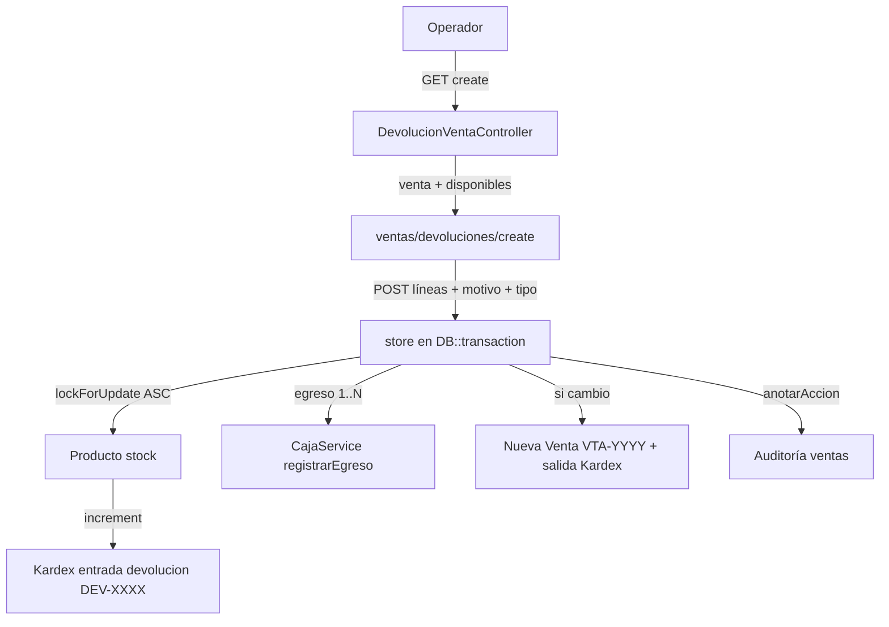
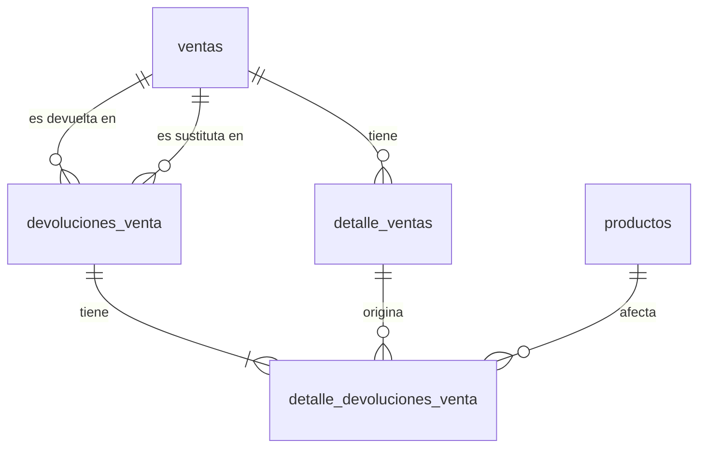

# Design Document — devoluciones-ventas

## Overview

Operación independiente de la anulación total que registra **devoluciones parciales** y **cambios** (devolución + nueva venta vinculada) sobre una `Venta` existente, sin modificarla ni eliminarla. Reutiliza los tres mecanismos actuales sin duplicarlos:

- **Stock:** `Producto::increment/decrement` atómico + `KardexService::registrarEntrada/registrarSalida` (el servicio nunca muta stock).
- **Caja:** `CajaService::getCajaActiva()` + `registrarEgreso` (egreso positivo = salida por devolución).
- **Auditoría:** `AuditServiceProvider` + `AuditModelObserver` + `anotarAccion()`.

### Decisiones de diseño clave

- **Nuevas tablas, venta intacta:** `devoluciones_venta` + `detalle_devoluciones_venta`. La venta y sus detalles jamás se actualizan; la disponibilidad se deriva (`vendida − ya devuelta`). Esto diferencia formalmente devolución vs `destroy` (borrado físico).
- **Línea trazada al detalle original:** el detalle de devolución referencia `detalle_venta_id` (no solo `producto_id`), lo que permite validar topes por línea y auditar qué línea se afectó.
- **Fuente Kardex propia `devolucion`:** se agrega a `KardexService::FUENTES` + CHECK PG. Alternativa descartada (reusar `fuente=venta` con `origen DEV-XXXX`) porque mezclaría anulaciones y devoluciones en el filtro de Kardex y rompería la etiqueta UI.
- **Cambio = devolución + nueva venta en una transacción:** `devolucion.tipo=cambio`, `venta_nueva_id` apunta a la `VTA-YYYY` creada con la lógica de `VentaController@store` (correlativo `max(id)+1`, `caja_id` activa). La salida del sustituto usa `fuente=devolucion, origen=DEV-XXXX` para no confundirla con una venta directa.
- **Caja con egresos prorrateados en mixto:** el CHECK de `egresos_caja` solo admite `efectivo,yape,transferencia,tarjeta` (sin `izipay/mixto`). Mapeo: `efectivo→efectivo`, `yape→yape`, `izipay→tarjeta`, `mixto→N egresos` según desglose. No se toca `calcularResumen` (ya suma `egresos_caja`, incluidos los de la devolución).
- **Sin permiso nuevo:** se reutiliza `acceso-ventas` (la anulación tampoco tiene permiso propio). Sin columna `estado` en ventas: no se introduce máquina de estados.
- **`inventario` intacto:** como en ventas, solo se mueve `stock` (compras/ajustes son los únicos que tocan `inventario`).

---

## Architecture

```
HTTP (auth + permiso acceso-ventas)
 │
 ├── GET  /ventas/{venta}/devoluciones/create → DevolucionVentaController@create
 ├── POST /ventas/{venta}/devoluciones        → DevolucionVentaController@store
 ├── GET  /devoluciones                        → DevolucionVentaController@index
 └── GET  /devoluciones/{devolucion}           → DevolucionVentaController@show
      (estáticas ANTES del resource ventas; mismo grupo que ventas)
 │
 ▼
DevolucionVentaController (inyecta CajaService, KardexService)
 ├── DevolucionVenta / DetalleDevolucionVenta ──► devoluciones_venta / detalle_devoluciones_venta
 ├── Venta / DetalleVenta (solo lectura + agregados de lo ya devuelto)
 ├── Producto ──► increment (devuelto) / decrement (sustituto)
 ├── KardexService ──► registrarEntrada / registrarSalida (fuente=devolucion)
 ├── CajaService ──► getCajaActiva / registrarEgreso (1..N egresos)
 └── AuditService ──► anotarAccion('registrar devolución'|'registrar cambio')
```



---

## Components and Interfaces

### 1. Migración `create_devoluciones_venta_table`

- `devoluciones_venta`: `id`, `correlativo` unique, `venta_id` FK `ventas` `restrict`, `venta_nueva_id` nullable FK `ventas` `nullOnDelete`, `caja_id` nullable FK `cajas` `set null`, `tipo` enum/string `devolucion,cambio` default `devolucion`, `motivo` string 500, `total_devuelto` decimal(10,2) default 0, `user_id` FK `restrict`, `timestamps`.
- `detalle_devoluciones_venta`: `id`, `devolucion_id` FK cascade, `detalle_venta_id` FK `detalle_ventas` `restrict`, `producto_id` FK `productos` `restrict`, `cantidad` integer, `precio_unitario` decimal(10,2), `subtotal` decimal(10,2), `timestamps`.
- En el mismo `up()`: `ALTER TABLE movimientos_kardex` — ampliar CHECK de `fuente` con `'devolucion'` (replicar patrón `2026_09_27_090000`; en SQLite el CHECK se ignora, en PG es exigible; test `KardexTest::test_check_de_postgres` debe seguir pasando).
- Correlativo `DEV-XXXX = DevolucionVenta::max('id')+1` zero-pad 4, generado dentro de la transacción (mismo patrón `VTA-XXXX`).

### 2. Modelos

```php
class DevolucionVenta extends Model {
  protected $fillable = ['correlativo','venta_id','venta_nueva_id','caja_id','tipo','motivo','total_devuelto','user_id'];
  protected $casts = ['total_devuelto' => 'decimal:2'];
  public function venta(): BelongsTo;          // original
  public function ventaNueva(): BelongsTo;     // sustituta (cambio)
  public function caja(): BelongsTo;
  public function user(): BelongsTo;
  public function detalles(): HasMany;         // DetalleDevolucionVenta
  public function egresos() // vía descripcion? No hay FK: se documenta por correlativo en descripción
}
class DetalleDevolucionVenta extends Model {
  protected $table = 'detalle_devoluciones_venta';
  protected $fillable = ['devolucion_id','detalle_venta_id','producto_id','cantidad','precio_unitario','subtotal'];
  public function devolucion(): BelongsTo;
  public function detalleVenta(): BelongsTo;
  public function producto(): BelongsTo;
}
```

`Venta` agrega (solo lectura, sin migraciones): `devoluciones(): HasMany(DevolucionVenta)` y helper `disponiblePorDetalle(detalleId): int`.

### 3. `KardexService` — una línea

Agregar a `FUENTES`: `'devolucion' => 'Devolución'`. Sin métodos nuevos: se usan `registrarEntrada` (devuelto) y `registrarSalida` (sustituto) existentes. Actualizar los `@param $fuente` docblocks.

### 4. `CajaService` — sin cambios

Se reutilizan `getCajaActiva()` y `registrarEgreso()`. No se usa `registrarIngresoCompensatorio` (es nota de crédito de compras con monto negativo). `calcularResumen` no se toca: los egresos de devolución ya restan del balance.

Mapeo `tipo_pago` (CHECK `efectivo,yape,transferencia,tarjeta`):

| `venta.metodo_pago` | Egresos generados |
|---|---|
| `efectivo` | 1 × `efectivo` = `total_devuelto` |
| `yape` | 1 × `yape` = `total_devuelto` |
| `izipay` | 1 × `tarjeta` = `total_devuelto` |
| `mixto` | 1..3 egresos prorrateados al desglose (`monto_efectivo→efectivo`, `monto_yape→yape`, `monto_izipay→tarjeta`), redondeo a 2 decimales con ajuste en la última línea |

Descripción: `"Devolución {DEV-XXXX} de {VTA-XXXX} ({motivo recortado})"` + `" [mixto: E=x Y=y I=z]"` cuando aplique.

### 5. `DevolucionVentaController`

Inyección: `__construct(private CajaService $cajaService, private KardexService $kardexService)`.

**`create(Venta $venta)`**: `$venta->load('detalles.producto','devoluciones.detalles')`; calcula por línea `vendida / devuelta / disponible`; devuelve `ventas.devoluciones.create`. Sin caja no se bloquea la consulta (solo el `store`).

**`store(Request, Venta $venta)`**:

```php
$caja = $this->cajaService->getCajaActiva();
if (!$caja) return back()->with('error_caja', true); // modal Caja Cerrada
$request->validate([
  'motivo' => ['required','string','max:500'],
  'tipo' => ['required','in:devolucion,cambio'],
  'lineas' => ['required','array','min:1'],
  'lineas.*.detalle_venta_id' => ['required','integer','exists:detalle_ventas,id'],
  'lineas.*.cantidad' => ['required','integer','min:1'],
  'producto_nuevo_id' => ['required_if:tipo,cambio','integer','exists:productos,id'],
  'cantidad_nueva' => ['required_if:tipo,cambio','integer','min:1'],
]);
DB::transaction(function () use (...) {
  // 1. Lock venta + líneas ordenadas ASC (lockForUpdate), verificar pertenencia a la venta
  //    y tope: cantidad <= vendida - yaDevuelta (SUM detalle_devoluciones por detalle_venta_id).
  // 2. Recalcular total_devuelto en servidor con precio_unitario ORIGINAL de cada DetalleVenta.
  // 3. Crear DevolucionVenta DEV-XXXX (caja_id, user_id).
  // 4. Por línea: crear DetalleDevolucionVenta; increment stock; registrarEntrada('devolucion', DEV-XXXX).
  // 5. Egresos 1..N según §4 (registrarEgreso).
  // 6. Si cambio: lock + validar stock sustituto; crear Venta VTA-YYYY (store-like);
  //    decrement + registrarSalida('devolucion', DEV-XXXX); set devolucion.venta_nueva_id.
  // 7. anotarAccion('registrar devolución' | 'registrar cambio').
});
// redirect()->route('devoluciones.show', $dev)->with('success', "Devolución {DEV} registrada correctamente.");
```

Validaciones extra dentro de la transacción (tras lock): línea pertenece a la venta; tope por línea; sustituto activo y con stock; venta no eliminada (si `destroy` corrió antes, el binding da 404).

**`index()`**: `DevolucionVenta::with('venta','user')->latest()->paginate(10)` → `devoluciones.index`.
**`show(DevolucionVenta)`**: `load('venta','ventaNueva','detalles.producto','detalles.detalleVenta','user','caja')`.

### 6. Rutas (`routes/web.php`, grupo `acceso-ventas`)

```php
// ANTES del resource ventas (estáticas primero):
Route::get('/ventas/{venta}/devoluciones/create', [DevolucionVentaController::class, 'create'])->name('ventas.devoluciones.create');
Route::post('/ventas/{venta}/devoluciones', [DevolucionVentaController::class, 'store'])->name('ventas.devoluciones.store');
Route::get('/devoluciones', [DevolucionVentaController::class, 'index'])->name('devoluciones.index');
Route::get('/devoluciones/{devolucion}', [DevolucionVentaController::class, 'show'])->name('devoluciones.show');
```

Sin `edit/update/destroy` de devoluciones (inmutables; un error se corrige con ajuste de inventario, no editando).

### 7. Vistas + JS

- `ventas.show`: botón "Devolver / Cambiar" → `ventas.devoluciones.create`; sección "Devoluciones" (correlativo, fecha `d/m/Y H:i`, tipo, motivo, total, usuario, venta nueva si cambio) + por línea `vendida / devuelta / disponible`.
- `ventas/devoluciones/create.blade.php`: solo init `window.venta = @json(...)` antes de `@vite(['resources/js/devoluciones/create.js'])`; modal `error_caja` idéntico al de ventas/compras; clases semánticas dark-mode; tabla `overflow-x-auto`.
- `devoluciones/index|show.blade.php`: listado `paginate(10)` + detalle con trazabilidad completa.
- `resources/js/devoluciones/create.js`: selección de líneas/cantidades con tope `disponible`, cálculo local del total (informativo; el servidor recalcula), `buscar-productos` para el sustituto. Nuevo `input` en `vite.config.js`.

### 8. Auditoría y permisos

- `AuditServiceProvider::$modelos` += `DevolucionVenta::class`; `AuditService::AUDITABLE` += idem; `modulos[DevolucionVenta] = 'ventas'`; `DetalleDevolucionVenta` queda excluido (como `DetalleVenta`); `AccionesAuditoriaController` += `'registrar devolución'`, `'registrar cambio'`.
- Permisos: sin cambios en `PermissionSeeder` (reutiliza `acceso-ventas`).

---

## Data Models

| devoluciones_venta | tipo |
|---|---|
| correlativo | varchar unique `DEV-XXXX` |
| venta_id | FK ventas restrict |
| venta_nueva_id | FK ventas nullable nullOnDelete |
| caja_id | FK cajas nullable set null |
| tipo | `devolucion,cambio` |
| motivo | varchar 500 |
| total_devuelto | decimal(10,2) |
| user_id | FK users restrict |

| detalle_devoluciones_venta | tipo |
|---|---|
| devolucion_id | FK cascade |
| detalle_venta_id | FK detalle_ventas restrict |
| producto_id | FK productos restrict |
| cantidad / precio_unitario / subtotal | int / decimal / decimal |



### Flujo store (devolución simple)

```
POST /ventas/{venta}/devoluciones
 ├── caja activa? no → error_caja
 ├── validate + lock ASC
 ├── tope por línea ok?
 ├── crear DEV-XXXX + líneas
 ├── por línea: increment stock + Kardex entrada (devolucion/DEV-XXXX)
 ├── egreso(s) registrarEgreso
 ├── anotarAccion('registrar devolución')
 └── redirect devoluciones.show
```

### Flujo cambio (misma transacción, tras lo anterior)

```
 ├── sustituto con stock? no → rollback total
 ├── crear VTA-YYYY (caja_id, user_id, metodo_pago=efectivo|igual al original*)
 ├── decrement + Kardex salida (devolucion/DEV-XXXX)
 └── devolucion.venta_nueva_id = VTA-YYYY + anotarAccion('registrar cambio')
```

\* `metodo_pago` de la nueva venta: `efectivo` por defecto o igual al original si el operador lo indica; la diferencia `total_nuevo − total_devuelto` queda como ingreso (nueva venta) vs egreso (devolución).

---

## Correctness Properties

### Property 1: La venta original nunca se modifica ni se elimina
*Para cualquier* devolución registrada, la `Venta` y sus `DetalleVenta` conservan idénticos atributos y siguen existiendo. **Validates: Req 5.1, 9.4.**

### Property 2: Tope por línea (vendida − ya devuelta)
*Para cualquier* línea y cualquier cantidad solicitada `q > disponible`, el sistema rechaza con error y no persiste nada. *Para* `q ≤ disponible`, acepta. **Validates: Req 5.3, 12.1, 12.2.**

### Property 3: Stock espejo con fuente devolucion
*Para cualquier* devolución de N líneas con cantidades `q_i`, el `stock` final de cada producto = inicial + `q_i`, existe exactamente 1 Kardex `entrada/devolucion/DEV-XXXX` por línea con `stock_despues = stock_antes + q_i`, y `inventario` no cambia. **Validates: Req 6.1, 6.2.**

### Property 4: Egreso compensatorio según método de pago
*Para cualquier* devolución con total `T` sobre venta de método `M`: existe(n) `EgresoCaja` en la caja activa cuya suma = `T`, con `tipo_pago` según mapeo §4 y descripción con `DEV-XXXX/VTA-XXXX`. **Validates: Req 7.2, 7.3, 7.4.**

### Property 5: Atomicidad total (incluye cambio)
*Para cualquier* fallo (tope, sin caja, sin stock del sustituto, excepción), no persiste ni cabecera, ni líneas, ni Kardex, ni egresos, ni venta nueva. **Validates: Req 8.3, 12.2.**

### Property 6: Cambio = devolución + venta vinculada
*Para cualquier* operación `tipo=cambio`, existe `devolucion.venta_nueva_id → VTA-YYYY` válida, con entrada Kardex del devuelto y salida Kardex del sustituto bajo el mismo `DEV-XXXX`. **Validates: Req 8.1.**

### Property 7: Anulación intacta y diferenciada
`DELETE /ventas/{venta}` sigue borrando con restauración total y su mensaje propio; la devolución crea registros nuevos con mensaje propio y la venta sigue listada. **Validates: Req 9.1, 9.2, 9.4.**

### Property 8: Auditoría completa
*Para cualquier* devolución/cambio, existe fila en `registros_auditoria` (`modulo=ventas`, acción correspondiente) con actor = `auth()->id()`, `fecha_movimiento = now()` y datos (motivo, totales, líneas). **Validates: Req 10.1–10.3.**

### Property 9: Sin caja no hay operación
*Para cualquier* `store` sin caja abierta, redirige con `error_caja` y persiste cero cambios. **Validates: Req 7.1.**

---

## Error Handling

| Situación | Respuesta |
|---|---|
| Sin caja activa | `back()->with('error_caja', true)` (modal Caja Cerrada → `caja.index`) |
| Cantidad > disponible / línea ajena / sin líneas / motivo vacío | 302 con errores por línea, cero persistencia |
| Sustituto sin stock o inactivo | 302 con error, rollback total |
| Venta inexistente (ya anulada) | 404 por Route Model Binding |
| Venta con devoluciones + `DELETE` | 302 con error explícito (no borra; la anulación solo aplica sin devoluciones) |
| Excepción inesperada | rollback automático + flash `"No se pudo registrar la devolución. Intente nuevamente."` |
| Condición de carrera en correlativo | índice único `DEV-XXXX` → rollback (aceptable en contexto local, igual que `VTA-XXXX`) |

Mensajes éxito: `"Devolución {DEV-XXXX} registrada correctamente."` / `"Cambio registrado: devolución {DEV-XXXX} y nueva venta {VTA-YYYY}."`.

---

## Testing Strategy

Feature tests (`RefreshDatabase`, SQLite memoria, `Permission::firstOrCreate('acceso-ventas')` + `givePermissionTo`, caja vía factory `abierta` o `CajaService::abrirCaja`, hora `America/Lima` con tiempos relativos) + property tests 100+ iteraciones (`// Feature: devoluciones-ventas, Property N:`). Servicios externos no intervienen (sin mocks necesarios). `vendor/bin/pint` antes de entregar; `composer run test` + `npm run test` si toca JS.

| Propiedad | Estrategia |
|---|---|
| P1 venta intacta | crear venta N líneas → devolver subset → `assertDatabaseHas` venta/detalles idénticos |
| P2 tope por línea | 100+ iter: `q = disponible + k` → 302 + `assertDatabaseMissing` devolución; `q = disponible` → 201/302 éxito |
| P3 kardex espejo | verificar `stock`, fila `entrada/devolucion`, `stock_antes/despues`, `inventario` igual |
| P4 egresos | matriz métodos (`efectivo,yape,izipay,mixto`) → suma = T + `tipo_pago` mapeado + descripción con correlativos |
| P5 atomicidad | forzar fallo (stock sustituto 0, tope) → cero filas en las 5 tablas |
| P6 cambio vinculado | `tipo=cambio` → `venta_nueva_id` existe + 2 movimientos mismo `DEV-XXXX` |
| P7 anulación intacta | `DELETE` existente sigue borrando; devolución no borra (`assertDatabaseHas` venta) |
| P8 auditoría | `registros_auditoria` con `accion = registrar devolución/cambio`, `usuario_id`, motivo en datos |
| P9 sin caja | sin caja abierta → `assertSessionHas('error_caja')` + cero cambios |

Tests de ejemplo: rutas registradas antes del resource; `create` muestra disponibles; `show` exhibe motivo/historial; total recalculado en servidor (enviar total adulterado → se ignora); `mixto` genera N egresos; zona horaria `America/Lima`.
